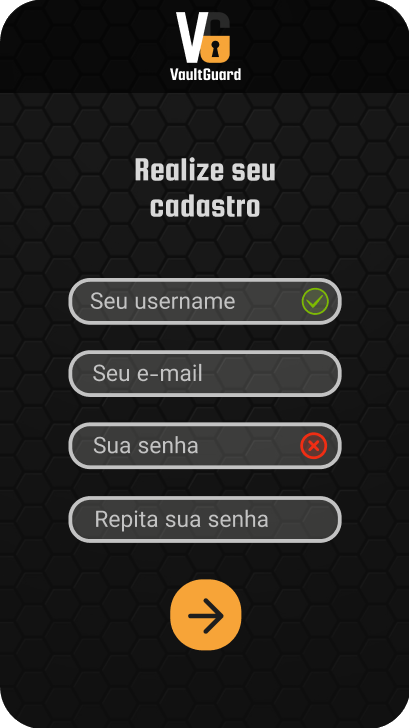
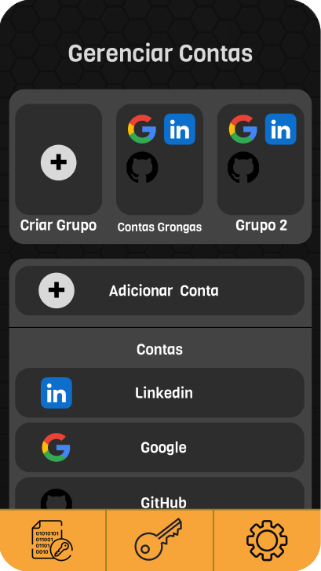
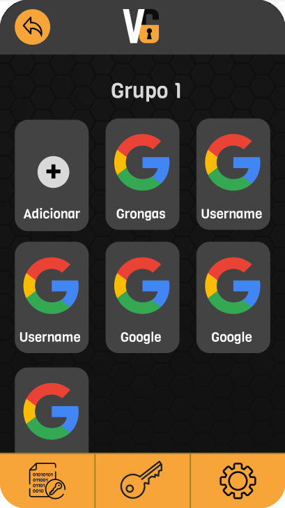
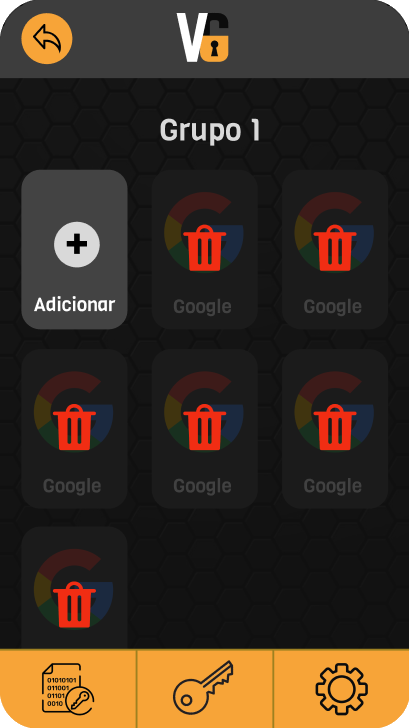
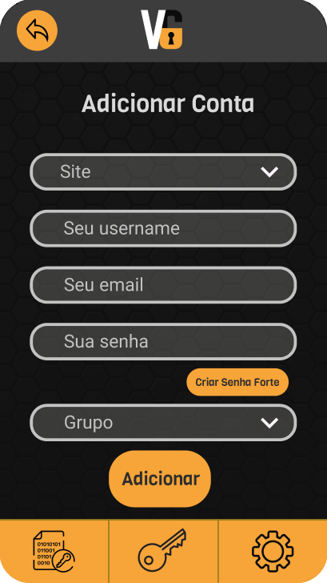
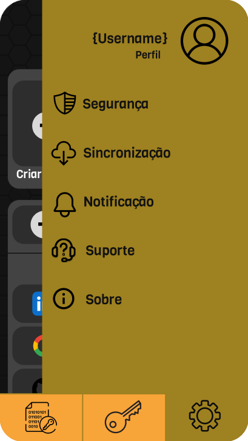

# 🔐 VaultGuard

VaultGuard é um aplicativo de gerenciamento e organização de senhas, desenvolvido com **Flutter** e integrado ao **Firebase**, com o objetivo de oferecer uma solução segura e intuitiva para armazenar suas credenciais com praticidade.

---

## 📱 Protótipo no Figma

Confira o design do app no Figma:  
🔗 [Protótipo VaultGuard](https://www.figma.com/design/ZJtU9tt8rFdM84LJCqSnFp/VaultGuard?node-id=0-1)

---

## ⚙️ Tecnologias Utilizadas

- **Flutter** – UI moderna e multiplataforma
- **Firebase Authentication** – Login seguro por e-mail/senha
- **Firebase Firestore** – Banco de dados em tempo real
- **flutter_secure_storage** – Armazenamento seguro local (criptografado)
- **Provider / Riverpod / Bloc** – Gerenciamento de estado (especifique se necessário)

---

## 🔐 Funcionalidades

- [x] Cadastro e login de usuários
- [ ] Criação, edição e exclusão de senhas
- [ ] Organização por categorias (redes sociais, bancos, etc.)
- [ ] Pesquisa por nome/plataforma
- [ ] Geração de senhas fortes
- [ ] Biometria / PIN para desbloqueio rápido
- [ ] Backup automático no Firebase
- [ ] Interface moderna e responsiva

---

## 📂 Estrutura do Projeto

A estrutura do VaultGuard segue boas práticas de organização em Flutter para facilitar a manutenção e escalabilidade.

```
lib/
├── main.dart                 # Ponto de entrada do aplicativo
├── screens/                 # Telas principais do app
│   ├── login_screen.dart
│   ├── register_screen.dart
│   ├── home_screen.dart
│   ├── password_list_screen.dart
│   └── password_detail_screen.dart
├── widgets/                 # Componentes reutilizáveis de UI
│   ├── password_card.dart
│   ├── custom_text_field.dart
│   └── vaultguard_logo.dart
├── services/                # Lógica de autenticação e banco de dados
│   ├── auth_service.dart
│   ├── database_service.dart
│   └── encryption_service.dart
├── models/                  # Estruturas de dados do app
│   └── password_entry.dart
├── utils/                   # Funções auxiliares e constantes
│   ├── constants.dart
│   └── helpers.dart
└── theme/                   # Configurações de tema e estilo
    └── app_theme.dart
```

---

## 🖼️ Capturas de Tela do Protótipo

Aqui estão algumas telas do protótipo atual do VaultGuard:

### 🔑 Tela de Login


### 📝 Tela de Cadastro


### 🏠 Tela Inicial


### 📂 Grupo de Contas


### ❌ Exclusão de Contas no Grupo


### ➕ Adicionar Conta


### ⚙️ Navbar de Opções


---

## 📦 Instalação

Clone o repositório e instale as dependências:

```bash
git clone https://github.com/Grongasx/vaultguard.git
cd vaultguard
flutter pub get
flutter run
```

---

## 🔐 Segurança

- As senhas são criptografadas localmente antes de serem enviadas para o Firestore.
- Os dados locais são armazenados com `flutter_secure_storage`.
- Planejamento para adicionar proteção por biometria e PIN.

---

## 🤝 Contribuições

Contribuições são bem-vindas!  
Sinta-se livre para abrir **issues** ou enviar **pull requests**.

---

## 📄 Licença

Este projeto está licenciado sob a [MIT License](https://mit-license.org/).

---

## ✨ Autor

Desenvolvido por **Gustavo Batista** – [@Grongasx](https://github.com/Grongasx)
